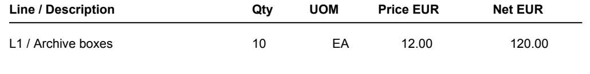

# Agent engineering: from evidence to a reliable recommendation

We are building an agent that helps a finance team investigate invoice exceptions. It gathers evidence when extracted values disagree with the invoice or business records, explains what remains uncertain, and prepares a recommendation for human review. Later, a lead investigator delegates a supplier follow-up to a correspondence specialist and pauses for a person to review the proposed email draft.

Use this guide as your workshop route: build the investigation, compare one prompt change, explain its results, then examine delegation and draft approval. The session guides provide the commands and task details.

This guide covers all four Parts on every starter branch. Links to later sessions open their published checkpoint; merge that checkpoint before running its commands. Keep this guide open as you move between sessions.

| Part | Your question | Your result |
|---|---|---|
| 1 · Build | How do a tool, an agent and a graph work together? | An investigation loop you can explain |
| 2 · Compare | What happens when we change one prompt? | One saved experiment across two scenarios |
| 3 · Explain and decide | Does that experiment support keeping the change? | An evidence-backed decision and a reviewed export |
| 4 · Delegate and review | When should a specialist help, and what does approval authorize? | Four inspected follow-ups and an approved or rejected draft recommendation |

## Before you arrive

Bring Git, Python 3.11 and your editor. Complete the [installation and preflight](session1.md#before-class-install-and-check-the-environment) before class. Start from `main` or `starter/session-1` and keep your work on your own branch.

If your group starts at Session 2, use the [advanced setup route](https://github.com/Data-Masterclass/Agentic-Engineering-Workshop/blob/starter/session-4/docs/advanced-route.md#1-install-from-the-session-2-checkpoint), then begin Part 2 below after the invoice orientation. Part 1's coding TODOs are not a prerequisite for Parts 2–4. Use this guide for the activities; Part 3 below reuses your Part 2 experiment.

Keep one clone, personal branch and virtual environment throughout. Use each linked checkpoint transition to preserve your edits. Live calls require released access and spending approval; scripted runs need no key. You do not need Docker or Phoenix. A shared trace walkthrough may use Phoenix; your own evidence is in the local reports.

## The invoice we start with

The extraction says **100 boxes**, but the invoice page shows **10**. Which evidence would justify a correction?



*Unaltered crop from [synthetic invoice INV-002, page 1](../data/invoices/reading-conflict.pdf). Open the PDF if your viewer cannot display the image.*

| Field | Invoice page | Supplied extraction |
|---|---|---|
| Quantity | **10 EA** | **100 EA** |
| Unit price | €12.00 | €12.00 |
| Net | €120.00 | €120.00 |

The [extraction fixture](../data/extractions/reading-conflict.json) deliberately contains the incorrect quantity. Arithmetic detects a disagreement; the page supplies evidence about which value was misread.

The workflow is **read → validate → investigate useful gaps → validate again → recommend → human review**. LangGraph controls the permitted paths; the investigator chooses evidence requests within them. LiteLLM provides approved live model access.

| Recommendation | Meaning |
|---|---|
| `READY_FOR_APPROVAL` | Mandatory checks pass; ready for a person's review |
| `NEEDS_CLARIFICATION` | Required evidence remains missing or ambiguous |
| `ESCALATE` | A blocking issue or terminal failure needs attention |

These exercises make recommendations. They do not send email, approve payment or update accounting records.

## Part 1 · Build an investigation you can explain

**Learn:** separate tool observations, model proposals and deterministic validation.

**Explore:** follow the invoice from extracted quantity 100 to page evidence 10. Locate the original extraction, current candidate and correction history. Contrast a matching invoice with an unreadable one: neither needs an invented correction.

### Your task

1. Open [Session 1: the three TODOs](session1.md#the-exercise-three-todos-about-20-minutes), with the [hints](session1-hints.md) alongside it.
2. Complete `review_pdf_page` in `src/workshop/tools.py`, `investigate`/`PROMPT` in `src/workshop/agent.py`, and `build_graph` in `src/workshop/graph.py`. Allow about 20 minutes; reading, parsing, validation and routing helpers are supplied.
3. Follow the Session 1 check commands. Open the printed `review.html` and find the page observation, accepted correction and final checks. Compare the `matching` and `missing-evidence` examples in the shared walkthrough or your own runs.
4. Save your intentional source edits on your personal branch. Keep credentials and reports out of Git.

**You are done when:** you can show why quantity 10 is supported, why the original 100 stays recorded, why matching can skip investigation, and why missing evidence stays unresolved. An unfinished check is a signal to get help; it does not block the prepared later sessions.

*Offline replies are fixed: they check the interaction, not prompt quality.*

## Part 2 · Run one controlled comparison

**Learn:** change one prompt while keeping the model, tools, data and other settings fixed.

**Explore:** the prepared investigator can consult supplier, order, receipt, invoice-history and PDF evidence. Each source has a defined scope and limits on what it can establish.

These scoped tools form the **context layer**: they supply relevant business information with its source and limitations. Graph state carries the case between steps; tools bring evidence into it. A record in a database is useful to the investigator only after a permitted tool returns it.

### Your task

1. Preserve your work using the [Session 1 → 2 transition](https://github.com/Data-Masterclass/Agentic-Engineering-Workshop/blob/starter/session-2/docs/session1-to-session2.md). Skip this transition if you started at Session 2.
2. Follow [Session 2, Steps 1–2](https://github.com/Data-Masterclass/Agentic-Engineering-Workshop/blob/starter/session-2/docs/session2.md#1-check-the-runner-offline): run the single scripted wiring check and prepare `outputs/session2-variants.json`. Keep the baseline unchanged; edit only the candidate prompt. Use the same approved model and settings in both. There are no new coding TODOs.
3. Before running, write: **“We change ____. We expect ____. Supporting evidence would be ____. A regression to watch is ____.”** Keep this note locally with the experiment.
4. After access and spending approval, follow [Session 2's live setup and run](https://github.com/Data-Masterclass/Agentic-Engineering-Workshop/blob/starter/session-2/docs/session2.md#3-run-the-live-experiment). This is **two scenarios × two prompts = four executions** in `outputs/session2-live`.
5. Use [Session 2's result inspection](https://github.com/Data-Masterclass/Agentic-Engineering-Workshop/blob/starter/session-2/docs/session2.md#4-inspect-and-explain-the-results). Open the CSV and each run's report. Identify one useful tool call and one continuation, stop or handoff supported by evidence.

| Scenario | Question to investigate |
|---|---|
| `order-gap` | Can the evidence establish an order association and source quantity? What remains unresolved? |
| `posted-copy` | Does matching history justify stopping on an already-posted invoice? |

**Save for Part 3:** your hypothesis, copied configuration and the complete `outputs/session2-live` directory. Keep all four executions together and unchanged; do not rerun into that folder. We will inspect this same experiment next.

**You are done when:** you can identify the one changed prompt, show both paired comparisons, and state what remains unknown. Actual cost is “unavailable” unless separately verified accounting is supplied; reservations are not charges.

**If live access is unavailable:** save the hypothesis and configuration. Continue Part 3 with a labelled scripted example or supplied compatible recording. Fixed replies cannot measure the effect of your prompt.

## Part 3 · Explain the result and decide

**Learn:** use the evidence from Part 2 to keep, reject or defer the proposed change. No second experiment is required.

**Explore:** choose a difference between the two tool paths. Was it useful, unnecessary, unsupported or blocked? Inspect the actual returned evidence before accepting the explanation.

### Your task

1. Preserve your work using the [Session 2 → 3 transition](https://github.com/Data-Masterclass/Agentic-Engineering-Workshop/blob/starter/session-3/docs/session2-to-session3.md). Keep the complete Part 2 experiment in place.
2. Use the commands below to inspect that saved experiment. They make **no model calls**:

   ```sh
   python -m workshop.session3 compare --input outputs/session2-live --output outputs/part3-review
   python -m workshop.session3 context --input outputs/session2-live --output outputs/part3-context
   ```

   Open `outputs/part3-review/comparison.html` and `outputs/part3-context/index.html`. Use fresh output names if these already exist. The [Session 3 guide](https://github.com/Data-Masterclass/Agentic-Engineering-Workshop/blob/starter/session-3/docs/session3.md) explains the views and comparison rules. Its course route uses this saved experiment. Steps 2–3 describe an optional further experiment; no second live batch is required.
3. Record a short decision locally, covering both scenarios:

   | Record | What to include |
   |---|---|
   | Hypothesis | The prompt change and expected effect recorded in Part 2 |
   | Evidence | Relevant trace event numbers, tool arguments and returned records |
   | Result | Outcomes, unresolved checks, attempts, elapsed time and any regression |
   | Cost | Verified actual cost, or “unavailable” |
   | Decision | **Keep, reject or defer**, with a reason and a limit on the conclusion |

4. Follow [Session 3's export review](https://github.com/Data-Masterclass/Agentic-Engineering-Workshop/blob/starter/session-3/docs/session3.md#5-review-the-sharing-export), using your **Part 2 input directory**:

   ```sh
   python -m workshop.session3 export --input outputs/session2-live --output outputs/part3-share.zip
   ```

   Open the ZIP before sharing. It contains a restricted comparison and traces, not your full workspace. Full configurations, notes and detailed evidence stay local. The command uploads nothing.

**You are done when:** another pair can follow your evidence, understand the decision and open the reviewed export. Two scenarios and one run per variant do not establish a general ranking or reliable performance gain. A well-supported “defer” is a valid result.

**If you have no live experiment:** follow [Session 3's offline demo](https://github.com/Data-Masterclass/Agentic-Engineering-Workshop/blob/starter/session-3/docs/session3.md#1-inspect-the-offline-trace-demo). Use `outputs/session3-demo` as the input to the inspection/export commands above and fresh output names. Record **“prompt effect not measured.”** Label any supplied recording as recorded results, not a fresh run of your configuration.

**Optional extension:** propose one refinement and a regression to check. Run it only if time, access and spending are approved, using [Session 3, Steps 2–3](https://github.com/Data-Masterclass/Agentic-Engineering-Workshop/blob/starter/session-3/docs/session3.md#2-choose-one-change). Create a new complete experiment; do not mix runs from different experiments.

## Part 4 · Delegate a supplier follow-up and review the draft

**Learn:** distinguish invoice evidence, specialist follow-up and permission to act.

**Explore:** invoice investigation finishes first. The lead chooses the next follow-up; a correspondence specialist can read selected supplier emails and recommend drafting or waiting. A proposed email does not resolve the invoice's missing evidence.

### Your task

1. Follow the [Session 3 → 4 transition](https://github.com/Data-Masterclass/Agentic-Engineering-Workshop/blob/starter/session-4/docs/session3-to-session4.md), then open [Session 4](https://github.com/Data-Masterclass/Agentic-Engineering-Workshop/blob/starter/session-4/docs/session4.md). No required coding TODOs or mailbox integration are added.
2. Use [Session 4, Step 1](https://github.com/Data-Masterclass/Agentic-Engineering-Workshop/blob/starter/session-4/docs/session4.md#1-inspect-the-roles-and-predict-the-actions) to locate both prompts, the correspondence tool and LangGraph's `interrupt()` approval node. Predict each route before running:

   | Scenario | What to decide |
   |---|---|
   | `supplier-request` | Does the available correspondence address the unreadable current invoice? |
   | `request-pending` | Is another request needed when a reply has already been promised? |
   | `internal-receipts` | Is the gap something the supplier or an internal team should investigate? |
   | `posted-copy` | What should happen when history confirms an already-posted record? |

3. Follow [Session 4, Step 2](https://github.com/Data-Masterclass/Agentic-Engineering-Workshop/blob/starter/session-4/docs/session4.md#2-run-the-four-scenarios-offline). Run all four scripted scenarios, inspect the exact proposed recipient, subject, body and references, and approve the draft for inclusion in the recommendation. Open the four reports and `summary.csv`.
4. Follow [Session 4, Step 3](https://github.com/Data-Masterclass/Agentic-Engineering-Workshop/blob/starter/session-4/docs/session4.md#3-inspect-the-evidence-and-reject-a-draft). Run `supplier-request` in a fresh folder and reject the draft. Compare the final recommendation, retained proposal and model/tool attempts.
5. Record the supporting invoice/email references and explain each route. Use [Session 4's completion checks](https://github.com/Data-Masterclass/Agentic-Engineering-Workshop/blob/starter/session-4/docs/session4.md#5-record-your-conclusion-and-check-completion).

**You are done when:** you can explain all four routes from returned evidence, show both approval and rejection, and explain why neither changes the invoice outcome or sends email. Selected emails are not a complete mailbox search.

Scripted runs establish routing, tool execution and approval/resume; they do not measure model judgment, live cost or a multi-agent advantage. Review occurs in the same running process; after exit, start a fresh run. Keep Part 4 reports and notes local—the Part 3 exporter does not support them. Optional live runs need separate access and spending approval.

## References when you need them

- [Repository workshop map](../README.md#workshop-flow): where each checkpoint fits.
- [LangGraph: Workflows and agents](https://docs.langchain.com/oss/python/langgraph/workflows-agents): fixed paths and model-directed decisions.
- [LangGraph: Graph API](https://docs.langchain.com/oss/python/langgraph/graph-api): state, nodes and edges.
- [LiteLLM Admin UI](https://docs.litellm.ai/docs/proxy/ui): model-access orientation; no deployment setup is required.
- [Data contract](data-contract.md): fixture structure and source limits.

Keep your code and useful results for continuation. Keep credentials, full reports, correspondence and private notes out of commits and review any export before sharing.
